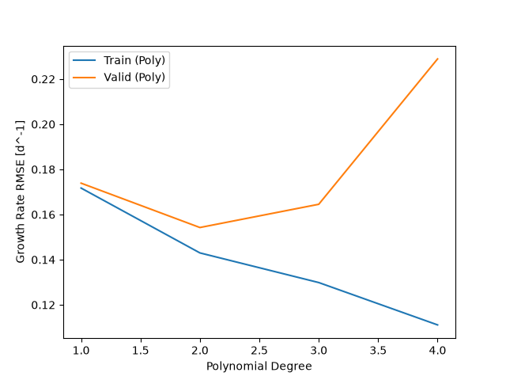
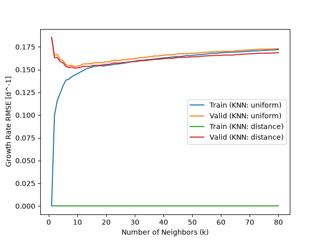
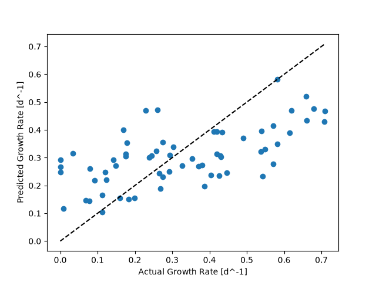

# Cell Growth Rate Prediction

This project develops a machine learning model to predict the specific growth rate of cells based on four operating conditions: temperature, pH, glucose concentration, and lactate concentration. 
Polynomial regression and k-nearest neighbors regression are trained, optimized, and compared using cross-validation and regression metrics. 
The project also investigates how operating conditions influence cell growth and identifies conditions associated with high and low growth rates.

## Highlights

- Developed machine learning models for cell growth prediction.
- Implemented polynomial and k-nearest neighbors regression models.
- Optimized model hyperparameters using cross-validation and GridSearchCV.
- Evaluated model performance using RMSE and R².
- Analyzed operating conditions influencing specific cell growth rates.

## Environment

- Python: 3.14.7
- matplotlib:3.11.0
- numpy: 2.5.2
- pandas: 3.0.5
- scikit-learn:1.9.0

## Code Design

### Data Loading and Preparation

The program begins by importing the required Python libraries and loading the cell growth dataset using Pandas. The dataset contains 4 input: temperature, pH, glucose concentration, and lactate concentration. The target variable is the specific growth rate of cells.
The input variables are separated from the target using Pandas, then converted into NumPy arrays for machine learning. This allows the same dataset to be used with different regression models.
The data is divided into training and testing sets using `train_test_split()`. The training set contains 80% of the observations, while the remaining 20% is reserved for testing. A `random_state` of 0 is used to make the split reproducible.
Keeping the testing data separate allows the final models to be evaluated on observations that were not used during training or hyperparameter optimization.

### Polynomial Regression

The first model uses polynomial regression to predict specific cell growth rates. A Scikit-learn pipeline combines `StandardScaler`, `PolynomialFeatures`, and `LinearRegression`.
`StandardScaler` standardizes the input variables, while `PolynomialFeatures` creates additional terms that allow the model to represent nonlinear relationships between operating conditions and growth rate. `LinearRegression` then fits the model using these transformed features.
The polynomial degree is optimized using `GridSearchCV` with four-fold cross-validation. Different degrees are evaluated using root mean squared error (RMSE), allowing the program to compare model complexity and prediction accuracy.
The best polynomial degree was 2, with a cross-validation RMSE of approximately 0.1542 d^-1. The optimized model achieved a testing RMSE of 0.1570 d^-1 and an R² of 0.3841.
The program also exports a comparison table and a figure showing how training and cross-validation errors change with polynomial degree. These results help identify whether increasing model complexity improves prediction performance or leads to overfitting.

### K-Nearest Neighbors Regression
The second model uses K-Nearest Neighbors (KNN) regression to predict specific cell growth rates. Unlike polynomial regression, KNN makes predictions based on nearby observations in the training dataset.
A Scikit-learn pipeline combines `StandardScaler` and `KNeighborsRegressor`. Standardization is important because KNN calculates distances between observations, and the four input variables have different scales.
The model is optimized using `GridSearchCV` with four-fold cross-validation. The program evaluates different numbers of neighbors and two weighting methods: `uniform` and `distance`.
The best configuration uses 9 neighbors with distance weighting. This model achieved a cross-validation RMSE of 0.1515 d^-1, a testing RMSE of 0.1587 d^-1, and a testing R² of 0.3707.
The training RMSE was 0 because distance weighting allows the model to reproduce its training observations exactly. This indicates a potential risk of overfitting.
The program exports a CSV table and a figure comparing KNN hyperparameter settings to evaluate their effect on prediction accuracy.

### Model Evaluation and Outputs
After hyperparameter optimization, both regression models are evaluated using the testing dataset. Their predictions are compared with the actual growth rates using root mean squared error (RMSE) and the coefficient of determination (R²).
RMSE measures the average prediction error, with lower values indicating better performance. R² indicates how much of the variation in growth rate is explained by the model.
The program exports a CSV table comparing the optimized polynomial and KNN models. It also generates an actual-versus-predicted scatter plot to visualize prediction accuracy.
Additional CSV tables and figures summarize the effects of polynomial degree and KNN hyperparameters on model performance.
Finally, the dataset is sorted by observed specific growth rate to identify the ten highest and ten lowest growth observations. These tables provide examples of operating conditions associated with different growth rates.
All results are saved in the `figures` and `tables` folders for further analysis.

## Analysis

### Model Selection and Performance
Two regression approaches were evaluated to predict specific cell growth rates: polynomial regression and K-Nearest Neighbors (KNN) regression.
Polynomial regression was selected because it can represent nonlinear relationships between the four operating conditions and cell growth rate. KNN regression was selected as an alternative approach that predicts growth rates using nearby observations rather than fitting a polynomial equation.
Both models were optimized using four-fold cross-validation and evaluated on the same testing dataset.

| Metric | Polynomial Regression | KNN Regression |
|---|---|---|
| Best configuration | Degree 2 | 9 neighbors, distance weighting |
| Cross-validation RMSE | 0.1542 | 0.1515 |
| Testing RMSE | 0.1570 | 0.1587 |
| Testing R² | 0.3841 | 0.3707 |

KNN achieved a slightly lower cross-validation RMSE, while polynomial regression achieved a slightly lower testing RMSE and higher testing R².
The differences are small, so neither model demonstrates a substantial advantage in prediction accuracy. However, polynomial regression is preferred for this project because it performs slightly better on the testing dataset and provides a more straightforward mathematical relationship between the input variables and predicted growth rate.
The testing R² values indicate that both models explain less than 40% of the observed variation in growth rate. Therefore, their predictions should be interpreted cautiously.

### Polynomial Degree and Model Complexity
Polynomial regression was optimized by testing polynomial degrees from 1 to 10 using four-fold cross-validation. Higher polynomial degrees allow the model to represent more complex nonlinear relationships between operating conditions and cell growth rates. However, increasing the degree also increases model complexity and the possibility of overfitting.
The best polynomial degree was **2**, with a cross-validation RMSE of **0.1542 d^-1**. This indicates that a quadratic model provided the best average cross-validation performance among the degrees tested.
The following figure compares training and cross-validation RMSE across different polynomial degrees.

The complete numerical results are available in [polynomial_comparison.csv](tables/polynomial_comparison.csv).

### KNN Hyperparameter Optimization and Overfitting
The KNN regression model was optimized by testing different numbers of neighbors, from 1 to 80, and two weighting methods: uniform and distance weighting.
Using fewer neighbors makes predictions more sensitive to nearby observations, while using more neighbors produces smoother predictions. Distance weighting gives greater importance to closer observations.
The best configuration was **9 neighbors with distance weighting**, achieving a cross-validation RMSE of **0.1515 d^-1**.
The training RMSE was **0**, while the testing RMSE was **0.1587 d^-1**. This difference indicates that the model reproduces its training observations exactly but does not achieve the same accuracy on unseen data. Therefore, overfitting is a potential concern.
The following figure compares KNN cross-validation RMSE for different numbers of neighbors and weighting methods.

The complete numerical results are available in [knn_comparison.csv](tables/knn_comparison.csv).

### Prediction Accuracy and Reliability
Both optimized models were evaluated using the same testing dataset, representing 20% of the original observations.
Polynomial regression achieved a testing RMSE of **0.1570 d^-1** and an R² of **0.3841**, while KNN achieved a testing RMSE of **0.1587 d^-1** and an R² of **0.3707**.
These results indicate that both models have limited predictive accuracy. Neither model explains most of the observed variation in cell growth rates.
The following figure compares actual and predicted growth rates for the KNN model. Points closer to the diagonal line represent more accurate predictions.

Polynomial regression was selected as the preferred model because of its slightly better testing performance and simpler mathematical interpretation.

### Effects of Operating Conditions on Cell Growth
The dataset contains four operating variables: temperature, pH, glucose concentration, and lactate concentration. Their relationships with specific cell growth rate can be investigated by comparing the conditions associated with the highest and lowest observed growth rates.

#### Temperature
Temperature is one of the input variables used to predict cell growth rate. Several observations with high growth rates occur between approximately 35.5 and 39.2 °C.
However, some observations with low growth rates also occur within this temperature range. This indicates that temperature alone cannot explain the variation in growth rate.
Polynomial regression accounts for nonlinear relationships involving temperature through polynomial terms and interactions with other variables.

#### pH
Several high-growth observations have pH values between approximately 6.73 and 7.19.
Some observations with zero growth have pH values farther from this range, including approximately 6.40, 6.50, 7.59, and 7.70.
These observations suggest that pH is associated with growth rate. However, low growth can also occur near neutral pH, indicating that other operating variables are important.

#### Glucose Concentration
Several high-growth observations have glucose concentrations between approximately 20 and 33 mM.
However, some observations with relatively high glucose concentrations also show low growth rates.
Therefore, higher glucose concentration does not necessarily correspond to higher cell growth. Its relationship with growth rate depends on the combination of operating conditions.

#### Lactate Concentration
Several high-growth observations have relatively low lactate concentrations, generally between 0 and approximately 11.3 mM.
In contrast, some observations with zero growth have higher lactate concentrations, including approximately 25.9, 26.6, 28.9, and 33.8 mM.
This suggests a negative association between lactate concentration and cell growth rate in the dataset.
However, low growth rates are also observed at lower lactate concentrations. Therefore, lactate alone cannot determine the growth rate.
Overall, the four operating variables should be considered together when predicting cell growth. The observed relationships describe patterns in the dataset and do not establish direct causal effects.

### High-Growth and Low-Growth Conditions
The dataset was sorted by observed specific growth rate to identify the operating conditions associated with the highest and lowest growth rates.
The program exports the ten highest-growth observations to [high_growth_conditions.csv](tables/high_growth_conditions.csv) and the ten lowest-growth observations to [low_growth_conditions.csv](tables/low_growth_conditions.csv).

#### High-Growth Conditions
The highest observed specific growth rate was approximately **0.750 d^-1**.
Several high-growth observations were associated with temperatures near 36–39 °C, pH values near 7, moderate glucose concentrations, and relatively low lactate concentrations.
These results suggest that combinations of these operating conditions may be associated with higher growth rates in the supplied dataset.

#### Low-Growth Conditions
The lowest observed specific growth rate was **0.000 d^-1**.
Some observations with zero growth were associated with relatively high lactate concentrations or pH values farther from neutral conditions.
However, low growth also occurred under other combinations of operating conditions. This indicates that no single variable can fully explain the observed growth rates.

#### Interpretation
The high-growth and low-growth tables contain observed values from the dataset rather than model predictions.
These observations help identify patterns in the operating conditions but do not establish optimal conditions or prove causal relationships.
Further experimental investigation would be necessary to determine whether changing these variables produces the same effects on cell growth.

### Model Limitations
Although both regression models successfully predict specific cell growth rates, their accuracy remains limited.
The polynomial regression model achieved a testing R² of **0.3841**, while KNN achieved **0.3707**. This indicates that both models leave a substantial portion of the observed variation unexplained.
The dataset contains only **318 observations**, which may limit the ability of the models to identify complex relationships between operating conditions and growth rates.
Another limitation is the possibility of overfitting. The KNN model achieved a training RMSE of zero but a higher testing RMSE, indicating that perfect predictions on training observations do not guarantee accurate predictions on unseen data.
Polynomial regression may also produce unreliable predictions outside the range of operating conditions represented in the training dataset.
Furthermore, the models were evaluated using one train-test split. Different splits could produce different testing results.
Therefore, predictions should be interpreted cautiously, particularly when evaluating operating conditions that are not well represented in the dataset.

### Potential Applications and Future Improvements
The developed regression models could support preliminary analysis of cell growth under different operating conditions.
For example, a process engineer could use the models to estimate growth rates based on temperature, pH, glucose concentration, and lactate concentration.
The models could also help identify operating conditions associated with higher growth rates and guide further experimental investigations.
However, their current accuracy is insufficient to rely on them exclusively for important process decisions.
Future improvements could include collecting additional observations, evaluating the models using independent experimental datasets, and investigating whether additional input variables improve prediction accuracy.
Further validation would also help determine whether the small performance differences between polynomial regression and KNN remain consistent.

### Conclusion
This project compared polynomial regression and K-Nearest Neighbors regression for predicting specific cell growth rates using four operating conditions.
Both models were optimized using four-fold cross-validation and evaluated on the same testing dataset.
KNN achieved a slightly lower cross-validation RMSE of **0.1515 d^-1**, while polynomial regression achieved a slightly lower testing RMSE of **0.1570 d^-1** and a higher testing R² of **0.3841**.
Based on testing performance and interpretability, **degree-2 polynomial regression was selected as the preferred model**.
The analysis also identified operating conditions associated with high and low observed growth rates. However, the limited prediction accuracy demonstrates that further data collection and model validation are necessary before using these predictions for practical process decisions.
Overall, the project demonstrates how machine learning can be applied to investigate relationships between operating conditions and cell growth while recognizing the limitations of regression models.
